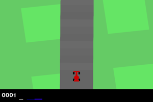
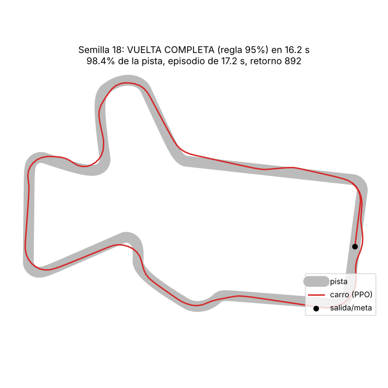
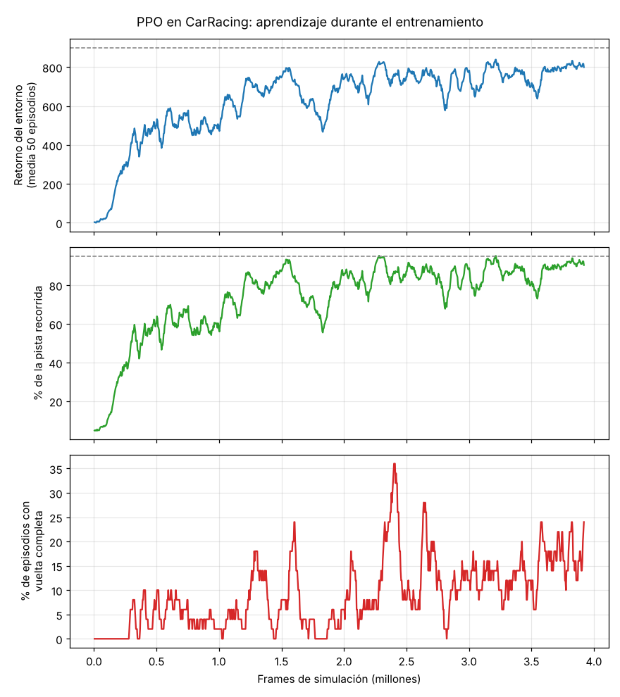
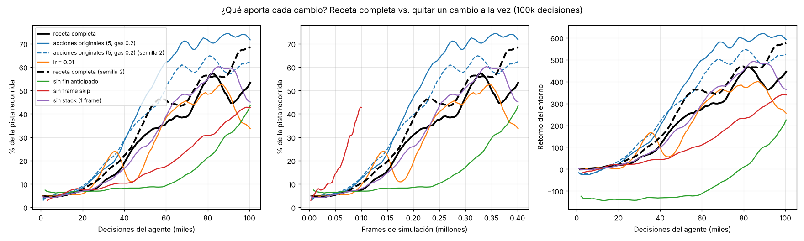
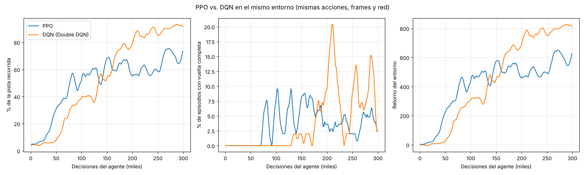

# Cómo aprendió el carrito a dar la vuelta (PPO en CarRacing)

Este documento explica **todo lo que se hizo** para que el agente pasara de no
avanzar (≈5–8% de la pista) a **completar vueltas enteras** en CarRacing, cuánto
aporta cada cambio (medido, no supuesto), y por qué PPO lo logró donde el DQN
anterior no.

## Resultado



**Sí, el carrito aprendió a dar la vuelta.** El modelo final
(`models/ppo_racer/ppo_racer_final.pt`) se entrenó 1.5M decisiones (6M frames,
2 h 53 min en 4 CPUs). Se evaluó en Monza (semilla 18) y en **20 pistas que
nunca vio** (semillas 1000–1019), con hasta 60 s por intento:

| Modelo | Vuelta oficial de Gymnasium (100% de baldosas) | Vuelta con la regla del 95% | Tiempo mediano de vuelta | Pista recorrida |
|---|---|---|---|---|
| Inicio (pesos aleatorios) | 0/21 | 0/21 | — | ~5% |
| Primer modelo que dio la vuelta (390k decisiones, 43 min) | 4/21 | 14/21 | 21.3 s | 83.5% |
| **Final (1.5M decisiones)** | **14/21 (67%)** | **19/21 (90%)** | **16.4 s** | **99.0%** |

(Evaluación con la acción más probable; el detalle por pista, y con acciones
muestreadas, está en `experiments/evaluacion_final.txt`.)

En Monza, la vuelta de la animación dura **16.2 s** con retorno 892 (la
primera vuelta en Monza, a los 43 min de entrenamiento, tardó 36 s e incluía
una salida a la hierba con trompos: `images/ppo_primera_vuelta_seed_18.png`).



> **Ojo con la definición de "vuelta".** Gymnasium documenta que una vuelta
> termina al volver a la salida con el 95% de las baldosas pisadas. Pero en
> Gymnasium 1.x ese chequeo está dentro de `if not tile.road_visited` y la
> baldosa de salida ya se pisa al arrancar, así que **nunca se cumple**: el
> entorno solo declara la vuelta al pisar el **100%** de las baldosas. Por eso
> se reportan los dos criterios. La mayoría de las "no vueltas oficiales" son
> vueltas completas en ~16 s a las que les faltaron 2–5 baldosas en una curva
> cerrada (ver `RacingEnv._on_finish_line_after_95` en `Utils/car_env.py`).


---

## 1. Cómo reproducirlo

```bash
pip install "gymnasium[box2d]" torch opencv-python-headless matplotlib pandas
```

```bash
python train_ppo.py --total-steps 1500000
```

```bash
python evaluate_ppo.py --model models/ppo_racer/ppo_racer_final.pt --seeds 18 --stochastic --plot --gif images/ppo_vuelta_seed_18.gif
```

```bash
python plot_progress.py
```

```bash
bash experiments/run_ablations.sh && python plot_experiments.py
```

| Archivo | Qué hace |
|---|---|
| `Utils/car_env.py` | Entorno CarRacing envuelto: acciones, frame skip, stack de frames, fin anticipado |
| `Agents/ppo_racer.py` | Red actor-crítico (CNN) y el algoritmo PPO |
| `train_ppo.py` | Entrenamiento con 8 simuladores en paralelo; guarda `models/ppo_racer/` |
| `evaluate_ppo.py` | Evalúa en pistas concretas, dibuja la trayectoria y graba GIFs |
| `plot_progress.py` | Curva de aprendizaje desde `progress.csv` |
| `train_dqn.py` | DQN moderno sobre el mismo entorno (para la comparación) |
| `experiments/run_ablations.sh` | Experimentos "quitar un cambio a la vez" + DQN |
| `plot_experiments.py` | Gráficas y tabla de esos experimentos |

Hardware usado: 4 CPUs, **sin GPU**. Todo corre en CPU.

---

## 2. Diagnóstico: por qué el código anterior no aprendía

Antes de entrenar nada se revisó el pipeline existente (`Examples/car_racing.py`,
`Utils/train.py`, `Agents/agentsCS.py`, `Agents/BaseAgent.py`,
`Utils/interpreters.py`). Los problemas no eran de "falta de entrenamiento":
había errores que impedían aprender por completo.

### 2.1 Problemas del entorno / preprocesamiento (afectaban a todos los agentes)

| Problema | Dónde | Efecto |
|---|---|---|
| `lap_complete_percent=0.07` | `Utils/train.py:52` | La "vuelta" se daba por completada con el 7% de la pista: la métrica de éxito no medía una vuelta real |
| `import Utils.track_creating` (archivo inexistente) | `Utils/train.py:8` | `main.py` y `TrainRun` fallan al importar |
| Acciones discretas originales | Gymnasium | El acelerador discreto es solo **0.2** y no se puede girar y acelerar a la vez |
| Imagen reducida a 32×32 | `Utils/interpreters.py:94` | Se pierde el detalle de los bordes de la pista |
| "Memoria" de movimiento con `0.01 * last_state` | `Utils/interpreters.py:100` | El frame anterior pesa 1%: prácticamente invisible, así que el agente no puede saber su velocidad ni su dirección |
| Sin frame skip | — | Una decisión por frame (50 por segundo). Las recompensas quedan muy lejos de las acciones que las causan |
| Sin fin anticipado | — | Si el carro se sale a la hierba, sigue 1000 frames sumando −0.1 sin aprender nada útil |

### 2.2 Problemas del DQN anterior (`Agents/agentsCS.py`, configuración en `Examples/car_racing.py`)

| Problema | Dónde | Efecto |
|---|---|---|
| Replay buffer de solo **1024** transiciones | `agentsCS.py:19` | ≈20 s de conducción; datos muy correlacionados |
| En **cada paso** recalcula los objetivos de las 1024 transiciones y entrena sobre todas (64 minibatches de 16) | `agentsCS.py:364`, `ExperienceDataset` | Sobreajuste a los últimos segundos y entrenamiento lentísimo (miles de forward por cada frame) |
| La red objetivo se copia cuando `len(actions) % c == 0` | `agentsCS.py:373` | Cuando el buffer se llena, `len` queda fijo en 1024 y 1024 % 32 == 0 → **se copia en cada paso**: en la práctica no hay red objetivo y el aprendizaje se vuelve inestable |
| El objetivo usa `make_decision(next_state)` (ε-greedy con ε=0.5) en vez del máximo | `agentsCS.py:301` | El objetivo de Q-learning se contamina con acciones aleatorias |
| `gamma = 1` | `car_racing.py:121` | Episodios de 1000 frames con −0.1 por frame: valores que no se acotan y mucha varianza |
| `epsilon = 0.5` fijo durante todo el entrenamiento | `car_racing.py:44` | La mitad de las acciones son aleatorias, incluso al final |

### 2.3 Problemas del PPO anterior (`Agents/BaseAgent.py`)

| Problema | Dónde | Efecto |
|---|---|---|
| Solo actualiza al final de cada episodio, con **300 épocas** sobre ese único episodio y minibatches de 8 | `car_racing.py:84-85` | Decenas de miles de pasos de gradiente sobre los mismos datos: la política colapsa |
| `alpha_policy = 0.01` | `car_racing.py:78` | Learning rate ~40× más alto de lo habitual para PPO |
| La pérdida de valor solo entrena la cabeza de valor, no la CNN compartida | `BaseAgent.py:83` | El crítico aprende sobre features pensadas solo para la política |
| `make_decision()` no recibe la observación y no existe `store_experience` | `BaseAgent.py:89` | Incompatible con `TrainRun` (que llama `make_decision(obs)` y `store_experience`) |
| Un solo entorno | — | Poca diversidad de experiencia por actualización |

---

## 3. Qué se cambió

### 3.1 Entorno (`Utils/car_env.py`)

1. **Gymnasium 1.x / `CarRacing-v3`** (Python 3.13). `CarRacing-v2` ya no existe; el entorno es el mismo.
2. **Vuelta real:** `lap_complete_percent = 0.95`, el valor oficial. Para que una vuelta cuente hay que pisar el 95% de las baldosas y volver a la meta.
3. **7 acciones discretas propias** sobre el modo continuo: nada, izquierda, derecha, **gas 1.0**, freno 0.8, izquierda+gas 0.5 y derecha+gas 0.5.
4. **Frame skip = 4:** cada decisión se repite 4 frames (12.5 decisiones por segundo). Además **solo se renderiza el último frame** (`FastCarRacing.skip_render`). Renderizar era ~75% del costo, así que la simulación va 3.7× más rápida.
5. **Stack de 4 frames** en escala de grises de 96×96: la red ve el movimiento (velocidad y dirección de giro).
6. **Se salta el zoom inicial:** los primeros 48 frames son una animación de la cámara.
7. **Fin anticipado:** si en **200 frames** (4 s) no pisa una baldosa nueva (está en la hierba, quieto o de reversa), el episodio termina con −20. El agente deja de perder tiempo en estados inútiles y aprende que salirse es malo.
8. **Límite de 2000 frames** por episodio. Cortar por tiempo no es un final real: se hace *bootstrap* con el valor del último estado.
9. **Recompensa × 0.1** para que los valores queden en un rango cómodo para la red.

### 3.2 Agente PPO (`Agents/ppo_racer.py`, `train_ppo.py`)

Receta estándar de PPO (Schulman et al. 2017; implementación tipo CleanRL):

| Hiperparámetro | Valor |
|---|---|
| Red | CNN "Nature DQN" (3 conv + 512) compartida por el actor (7 logits) y el crítico (1 valor), inicialización ortogonal |
| Entornos en paralelo | 8 (`AsyncVectorEnv`) |
| Rollout | 128 pasos × 8 entornos = 1024 transiciones por actualización |
| Épocas / minibatch | 4 épocas, minibatches de 256 |
| Learning rate | 2.5e-4 con decaimiento lineal hasta 0 |
| γ / λ (GAE) | 0.99 / 0.95 |
| Clip | 0.1 |
| Coef. entropía / valor | 0.01 / 0.5 |
| Grad clip | 0.5 |
| Presupuesto | 1.5M decisiones = 6M frames |

Diferencias clave con el PPO anterior: se actualiza cada 1024 pasos (no al final
de cada episodio), con 4 épocas (no 300), un lr 40× menor, ventajas
normalizadas, la pérdida de valor entrena toda la red y hay bonus de entropía
para que siga explorando.

## 4. Cómo fue el entrenamiento



Datos completos en `models/ppo_racer/progress.csv` (una fila por cada
actualización de PPO, es decir, cada 1024 decisiones).

| Hito | Decisiones | Frames | Minutos |
|---|---|---|---|
| Recorre el 25% de la pista | 42k | 168k | 4.4 |
| Primera vuelta completa (en entrenamiento) | 71k | 283k | 7.4 |
| Recorre el 50% de la pista | 75k | 299k | 7.9 |
| Recorre el 75% | 262k | 1.05M | 29 |
| Recorre el 90% | 379k | 1.52M | 41 |
| Primera vuelta en Monza (evaluación) | 390k | 1.56M | 43 |
| Final: 95% de la pista, retorno 847 | 1.5M | 6M | 173 |

Observaciones:

* **Lo más rápido es aprender a acelerar y seguir la pista:** en 8 minutos pasa
  del 5% al 50%. Lo lento es pulir las curvas cerradas, donde se sale y pierde
  baldosas.
* **La curva tiene caídas** (por ejemplo a los ~1.8M y ~2.8M frames). Es normal
  en PPO: una actualización empeora la política y las siguientes la corrigen.
  El decaimiento del learning rate hace que al final sea más estable.
* **La tasa de vueltas en entrenamiento (15–40%) subestima al agente.** En
  entrenamiento los episodios se cortan a los 40 s, las acciones son
  aleatorias (se muestrean de la política) y hace falta el 100% de las
  baldosas. En evaluación, con 60 s, la misma política da la vuelta en el
  67% de las pistas (100%) o en el 90% (regla del 95%).
* **La entropía baja de 1.94 (azar puro con 7 acciones) a ~0.65:** la política
  se vuelve más decidida, sin colapsar a una sola acción.
* **Política estocástica vs. la acción más probable:** a mitad del
  entrenamiento, tomar siempre la acción más probable hacía que el carro se
  quedara girando en círculos (29% de la pista frente a 67% muestreando). Con
  el modelo final ambos modos rinden parecido.


## 5. ¿Qué aporta cada cambio? (ablaciones)

Para no suponer, se midió: partiendo de la receta final, se **quita un cambio a
la vez** y se entrena 100k decisiones, con el mismo ritmo de learning rate que
el run principal (`--anneal-steps 1500000`). La línea negra son las primeras
100k decisiones del run principal. Script: `experiments/run_ablations.sh`;
gráfica y tabla: `python plot_experiments.py`.



<!-- TABLA_ABLACIONES -->

Cómo leer los resultados:

* **Fin anticipado: el cambio que más pesa al principio.** Sin él, el agente
  pasa ~60k decisiones atascado en ~8% de la pista. Cada episodio malo dura
  2000 frames en la hierba sumando −0.1 por frame (retorno ≈ −140), así que casi
  toda la experiencia es basura repetida. Cortando a los 4 s sin progreso, cada
  episodio inútil cuesta poco y la penalización le enseña a no salirse.
* **Frame skip: cambia qué cuesta qué.** Por *decisión* (cada una cuesta un
  paso de la red), sin frame skip se aprende menos: 42% vs 50%. Con frame
  skip, γ = 0.99 cubre ~8 s de conducción en vez de ~2 s, y cada acción tiene
  un efecto visible en la imagen. Por *frame* simulado es al revés: sin skip
  se aprovecha mejor cada frame, pero los frames del skip son casi gratis
  porque no se renderizan.
* **Stack de 4 frames: casi no aporta en esta etapa** (49% vs 50%). La barra
  inferior de la imagen de CarRacing ya muestra la velocidad, los sensores ABS,
  el volante y el giroscopio, así que un solo frame ya trae la información de
  movimiento. Esto explica en parte por qué el intérprete viejo (que casi
  borraba el frame anterior) no era el problema principal.
* **lr = 0.01: inestable.** Sube y se cae dos veces (24% → 11%, 52% → 34%).
  El lr alto del PPO anterior era parte del problema.
* **Acciones originales: sorpresa, aprenden *más rápido* al principio.**
  Con el acelerador limitado a 0.2 el carro va más lento y se sale menos, así
  que recorre más pista temprano (72% vs 50%). Las 7 acciones propias **no**
  fueron la razón del éxito inicial. Lo que no se midió es si con gas 0.2 se
  llega a vueltas de ~16 s como las del modelo final, que acelera a fondo en
  las rectas; haría falta un run completo de 1.5M decisiones.

<!-- SEMILLA2 -->

> **Advertencias.** Cada configuración es una sola semilla: diferencias de
> menos de ~10 puntos pueden ser ruido. 100k decisiones es el arranque del
> aprendizaje; un cambio que no ayuda al principio puede ayudar al final, y al
> revés. Los minutos no son comparables entre corridas: el run principal usó
> 4 hilos y las ablaciones 2, porque a las ~3 h de uso continuo la máquina
> virtual empezó a ir mucho más lenta con 4 hilos (una multiplicación de
> matrices con 4 hilos tardaba 5.6× más que con 1). Por eso las gráficas usan
> decisiones y frames, no tiempo.


## 6. ¿Por qué PPO sí dio la vuelta y el DQN anterior no?

**Respuesta corta: no fue por ser PPO.** El DQN anterior fallaba por errores
de implementación y de configuración (sección 2), no por el algoritmo. Para
comprobarlo se escribió un DQN moderno (`train_dqn.py`) y se entrenó en
**exactamente el mismo entorno nuevo**: mismas 7 acciones, frame skip, stack,
fin anticipado y la misma CNN. **También aprendió a dar la vuelta.**



| | PPO | DQN moderno |
|---|---|---|
| % de pista en entrenamiento a las 300k decisiones | 69% | **92%** |
| Evaluación (21 pistas): vuelta oficial, 100% de baldosas | 4/21 (modelo de 390k) · 14/21 (final, 1.5M) | 9/21 (300k) |
| Evaluación (21 pistas): regla del 95% | 14/21 (390k) · 19/21 (final) | **21/21** (300k) |
| Tiempo mediano de vuelta | 21.3 s (390k) · **16.4 s** (final) | 28.5 s |
| Gradiente por decisión | 4 muestras (4 épocas × 1) | 8 muestras (batch 64 cada 8 decisiones) |

Detalle por pista: `experiments/evaluacion_dqn.txt`. Trayectoria del DQN en
Monza: `images/dqn_vuelta_monza_seed_18.png`.

Con el mismo número de decisiones, el DQN moderno aprendió **más** que PPO:
reutiliza cada transición muchas veces gracias al replay buffer (50k). PPO,
en cambio, usa cada dato 4 veces y lo descarta. El DQN maneja más
conservador (vueltas de ~28 s); el PPO final, con 5× más entrenamiento, va
casi al doble de velocidad. Con esta evidencia no se puede decir que un
algoritmo sea mejor que el otro en CarRacing: ambos funcionan si están bien
implementados.

### Entonces, ¿qué diferencia al DQN que falló del que funcionó?

| | DQN anterior | DQN moderno (`train_dqn.py`) |
|---|---|---|
| Replay buffer | 1024 transiciones (~20 s) | 50 000 transiciones |
| Entrenamiento por paso | Recalcula los 1024 objetivos y entrena 64 minibatches en **cada** frame | 1 minibatch de 64 cada 8 decisiones |
| Red objetivo | Se copia en cada paso cuando el buffer se llena (bug de `len % c`) | Se copia cada 1000 pasos de gradiente |
| Objetivo | `Q_hat(s', a')` con `a'` ε-greedy (ε=0.5) | Double DQN: la red online elige `a'` y la objetivo la evalúa |
| γ | 1 | 0.99 |
| Exploración | ε = 0.5 fijo | ε de 1.0 a 0.05 en el primer 20% |
| Pérdida | MSE | Huber + recorte del gradiente a 10 |
| Entorno | 32×32, frame anterior al 1%, sin frame skip, gas 0.2, vuelta al 7% | El entorno nuevo de la sección 3 |

En resumen, el carrito aprendió por tres cosas que valen para cualquier algoritmo:

1. **Un entorno que deja aprender:** fin anticipado al salirse, frame skip, la
   imagen completa a 96×96 y una definición de vuelta real.
2. **Una implementación correcta del algoritmo**, sin bugs como la red objetivo
   que se copia en cada paso o las 300 épocas sobre un solo episodio.
3. **Hiperparámetros estándar** (lr 2.5e-4 o 1e-4, γ = 0.99) en vez de valores
   extremos (lr 0.01, γ = 1, ε = 0.5).


## 7. Limitaciones y siguientes pasos

* **No todas las vueltas son "oficiales".** El modelo final pisa el 100% de
  las baldosas en el 67% de las pistas. En las demás se salta 2–5 baldosas en
  una curva cerrada y luego da vueltas buscando las que le faltan. Ideas para
  arreglarlo: entrenar con más de 40 s por episodio, penalizar salirse de la
  pista o seguir entrenando.
* **Una sola semilla por experimento** (salvo las dos que se repitieron). Para
  afirmaciones fuertes harían falta 3–5 semillas.
* **Las ablaciones solo cubren el arranque** (100k decisiones). En particular,
  falta comprobar si las acciones originales (gas 0.2) llegan a vueltas tan
  rápidas como las del modelo final.
* **CPU limitada.** Con GPU, o más núcleos para más entornos en paralelo, el
  mismo entrenamiento tomaría una fracción del tiempo.
* **El código anterior queda como estaba** (`Examples/car_racing.py`,
  `Utils/train.py`, `Agents/agentsCS.py`, `Agents/BaseAgent.py`). Se documentó
  por qué falla, pero no se reparó: el pipeline nuevo es independiente.
  `Utils/train.py` sigue importando `Utils/track_creating.py`, que no existe.

